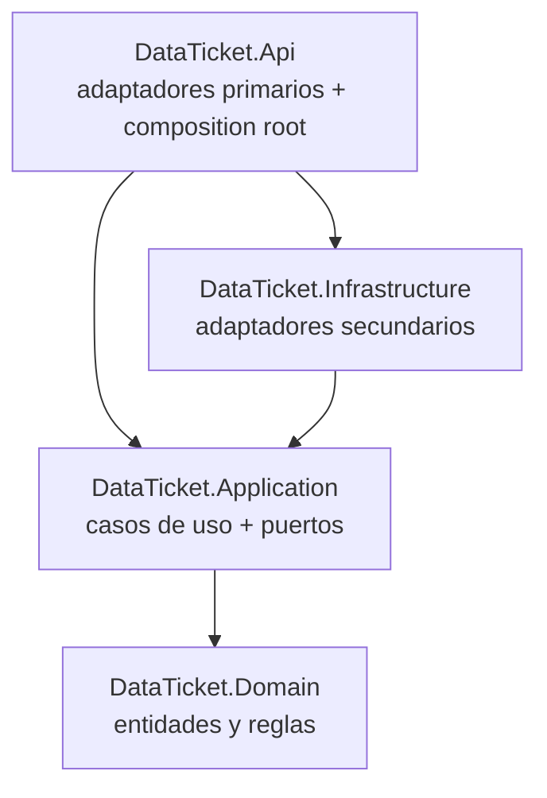

# Backend hexagonal

El backend (`backend/`, C# sobre .NET 10) sigue **puertos y adaptadores**: el dominio y los casos de uso no conocen la web, la base de datos ni SignalR; todo lo externo entra o sale por interfaces ([[adr-0002-backend-hexagonal]]).

## Proyectos y regla de dependencias

| Proyecto | Contiene | Puede depender de |
|---|---|---|
| `DataTicket.Domain` | Entidades, value objects, enums, invariantes ([[modelo-de-dominio]]) | Nada |
| `DataTicket.Application` | `Ports/In` (casos de uso), `Ports/Out` (repositorios, `IEmailSender`, `IFileStorage`, `ITicketChatNotifier`, `ICurrentUser`, `IClock`), implementación de casos de uso, DTOs | `Domain` + abstracciones de DI |
| `DataTicket.Infrastructure` | `Persistence/` (EF Core, configuraciones, migraciones), `Identity/`, `Storage/` (Blob), `Email/` (SMTP) | `Application`, EF Core, Npgsql, ASP.NET Core |
| `DataTicket.Api` | `Endpoints/` (minimal APIs), `Auth/` (cookie, antiforgery, políticas y adaptador de `ICurrentUser`), `Realtime/` (hub `/hubs/tickets` y notificador), `Health/`, `Program.cs` | `Application`, `Infrastructure` |

La regla se **verifica en cada `dotnet test`** (ejecutado dentro de `backend/`) con `tests/DataTicket.ArchitectureTests`:

| Clase | Reglas |
|---|---|
| `LayerDependencyTests` | `Domain` no referencia ninguna otra capa ni frameworks (tampoco `Microsoft.Extensions*`). `Application` no referencia `Infrastructure` ni `Api`, ni `Microsoft.AspNetCore*`, `Microsoft.EntityFrameworkCore*` o `Npgsql`. `Infrastructure` no referencia `Api`. `DataTicket.UnitTests` no referencia adaptadores ni esos frameworks |
| `PortLocationTests` | Toda interfaz de `Application` vive en `Ports.In` o `Ports.Out` |
| `CurrentUserPortTests` (B4) | `ICurrentUser` es una interfaz de `DataTicket.Application.Ports.Out`. Ningún miembro suyo expone tipos de ASP.NET Core. Toda clase que la implemente en los cuatro ensamblados de producción vive en `DataTicket.Api.Auth` (el adaptador lee la petición HTTP), y debe existir al menos una |
| `EndpointOnlyContentTests` (B4) | `DataTicket.Api` no llama a middleware que sirva contenido sin endpoint (`UseStaticFiles`, `UseDefaultFiles`, `UseFileServer`, `UseHealthChecks`, ramas `Map`/`MapWhen`/`Run`, Swagger o ReDoc por middleware, `UseSpa`): la política de reserva solo protege endpoints ([[autenticacion-identity]]) |

## Mapa funcional → puertos (propuesta)

| Funcionalidad | Puerto de entrada (caso de uso) | Puertos de salida | Adaptadores |
|---|---|---|---|
| Radicación ([[flujo-del-ticket]]) | `SubmitTicket` | `ITicketRepository`, `IFileStorage`, `IAuditLog` | HTTP · EF Core · Blob |
| Triage y participantes | `AssignParticipants`, `RemoveParticipant`, `TakeTicket` | `ITicketRepository`, `IEmailSender`, `IChatConnectionRevoker` | HTTP · EF Core · SMTP · SignalR |
| Chat ([[chat-interno]]) | `SendChatMessage`, `MarkMessageRead`, `GetChatHistory` | `IChatRepository`, `ITicketChatNotifier` | Hub · EF Core · SignalR |
| Respuesta formal y cierre | `DeliverFormalResponse`, `CloseTicket` | `ITicketRepository`, `IEmailSender`, `IAuditLog` | HTTP · EF Core · SMTP |
| Portal cliente | `ListClientTickets`, `GetClientTicket` | `IClientTicketQueries` | HTTP · EF Core |
| Inicio y cierre de sesión ([[autenticacion-identity]]) — **implementado en B3** | `SignIn`, `SignOut` (puertos `ISignIn`, `ISignOut`) | `ICredentialVerifier`, `IUserSession` | HTTP · Identity |
| Contexto del usuario, `GET /api/auth/me` ([[autenticacion-identity]]) — **implementado en B4** | `GetCurrentUserProfile` (puerto `IGetCurrentUserProfile`) | `ICurrentUser`, `ICompanyDirectory` | HTTP · claims de la cookie (`HttpContextCurrentUser`) · EF Core (`CompanyDirectory`) |

Nombres según [[glosario]]. Es una guía de partida: se ajusta al implementar y se documenta aquí. Solo las dos filas de autenticación (sesión y contexto del usuario) existen ya en el código.

### Puertos y adaptadores de B4 (HU-004)

| Pieza | Tipo | Ubicación | Papel |
|---|---|---|---|
| `ICurrentUser` | Puerto de salida | `Application/Ports/Out` | Usuario de la sesión: `IsAuthenticated`, `UserId`, `DisplayName`, `Email`, `Surface`, `Roles`, `Teams`, `CompanyId`, `IsInRole`. Todo sale de la sesión, nada de la petición; falla cerrado si el perfil no es válido |
| `ICompanyDirectory` | Puerto de salida | `Application/Ports/Out` | `FindNameAsync(companyId)`: nombre de la empresa o `null` si no existe |
| `IGetCurrentUserProfile` (+ `CurrentUserProfile`, `CurrentUserCompany`) | Puerto de entrada | `Application/Ports/In/Authentication` | Perfil del usuario actual; sin parámetros; `null` si no hay perfil válido |
| `GetCurrentUserProfile` | Caso de uso | `Application/Authentication` | Compone el perfil desde `ICurrentUser` y el nombre de la empresa; registrado en `AddApplication()` |
| `HttpContextCurrentUser` + `PrincipalProfile` | Adaptador de `ICurrentUser` | `Api/Auth` | Lee los claims del principal de la petición. `PrincipalProfile` es la lectura única que comparten el adaptador y las políticas con nombre |
| `CompanyDirectory` | Adaptador de `ICompanyDirectory` | `Infrastructure/Persistence` | Consulta EF Core sobre `dataticket.companies`; registrado en `AddInfrastructure()` |
| `DataTicketClaimsPrincipalFactory` (+ `DataTicketClaimTypes`) | Adaptador de Identity | `Infrastructure/Identity` | Emite los claims de la cookie; `company_id` y `display_name` solo desde la cuenta |

`ICurrentUser` es el único puerto de salida cuyo adaptador vive en `Api` y no en `Infrastructure`: su fuente es la petición HTTP. `PrincipalProfile` (en `Api`) lee los nombres de claim de `DataTicketClaimTypes` (en `Infrastructure`), dependencia que la regla de capas permite. Detalle en [[autenticacion-identity]].

## Convenciones

- Código en inglés; mensajes y comentarios en español.
- `Directory.Build.props`: `net10.0`, `Nullable`, `ImplicitUsings`, **`TreatWarningsAsErrors`**.
- `Directory.Packages.props`: versiones centralizadas (los `.csproj` no llevan `Version`).
- `global.json`: SDK 10.0.x (`rollForward: latestFeature`) y `test.runner = Microsoft.Testing.Platform`.
- Autorización dentro de los casos de uso con `ICurrentUser`; las políticas de endpoint son la primera barrera, no la única ([[roles-y-permisos]]). Un caso de uso nunca recibe la empresa del usuario como dato de entrada: la lee de `ICurrentUser.CompanyId`.
- Configuración tipada con el patrón Options. Claves esperadas: `ConnectionStrings:DataTicket`, `Email:Smtp:*`, `Email:FromAddress`, `Storage:Blob:*` ([[entorno-docker]]). Desde B3 también `Persistence:ApplyMigrationsOnStartup`, que solo se honra en Development, y desde B7 `Seed:Enabled` y `Seed:DefaultPassword` (sembrador de Development; solo en `appsettings.Development.json`, que no se publica) ([[persistencia-postgresql]]).
- **Puertos de entrada**: una carpeta por área en `Application/Ports/In/<Area>` con la interfaz del caso de uso y sus tipos de entrada y resultado (p. ej. `ISignIn`, `SignInCommand`, `SignInOutcome`); la implementación va en `Application/<Area>` y se registra en `AddApplication()`.
- **Endpoints HTTP**: minimal APIs en `Api/Endpoints/<Area>`, mapeados **dentro del grupo raíz `/api`** de `Program.cs` (`app.MapGroup("/api").RequireAntiforgeryValidation()`). Tres convenciones, cada una con su prueba en `tests/DataTicket.IntegrationTests/Conventions` ([[estrategia-de-pruebas]], [[autenticacion-identity]]):
  - **Antiforgery.** El grupo lleva el filtro `AntiforgeryValidationFilter` y el marcador `AntiforgeryValidationMetadata`. Una mutación de `/api` mapeada fuera del grupo no queda cubierta y `AntiforgeryConventionTests` la delata.
  - **Sesión por defecto.** Todo endpoint exige sesión por la política de reserva, aunque no declare nada. Un endpoint público lleva `AllowAnonymous` **explícito** y obliga a actualizar la lista literal de `EndpointAuthorizationConventionTests`, que exige igualdad exacta.
  - **La empresa no entra por la petición.** Ningún endpoint al que pueda llegar un cliente declara la empresa en la ruta, la consulta, las cabeceras, el formulario ni el cuerpo (`ClientInputConventionTests`).
  - Excepciones al grupo: las sondas de salud (`Health/`, solo `GET`) y el documento OpenAPI (solo Development) se mapean directamente sobre la aplicación.

## Cómo añadir una funcionalidad

1. Prueba de dominio/caso de uso que falle (TDD, [[estrategia-de-pruebas]]).
2. Entidad o regla en `Domain`; caso de uso y puertos en `Application`.
3. Adaptadores en `Infrastructure` (y migración si cambia el esquema, [[persistencia-postgresql]]).
4. Endpoint (dentro del grupo `/api`) o método del hub en `Api`; registro en `AddApplication()` / `AddInfrastructure()`. El endpoint exige sesión por defecto: añade la política con nombre que corresponda ([[roles-y-permisos]]) y, solo si debe ser público, `AllowAnonymous` más su entrada en la lista de `EndpointAuthorizationConventionTests`.
5. Si se crea un proyecto nuevo: agregarlo a `DataTicket.slnx`, a la etapa `restore` del `backend/Dockerfile` y a las pruebas de arquitectura.

## Estado actual

| Elemento | Estado |
|---|---|
| Cuatro proyectos + regla de dependencias (`DataTicket.ArchitectureTests`: capas, `DataTicket.UnitTests` sin adaptadores ni frameworks, interfaces de `Application` solo en `Ports.In`/`Ports.Out` y, desde B4, puerto `ICurrentUser` con su adaptador solo en `Api`) | Hecho |
| `DataTicketDbContext` (Identity, `Company` y claves de Data Protection) + migración `AddIdentityAndCompanies` + health check de PostgreSQL ([[persistencia-postgresql]]) | Hecho (B3 del goal del login) |
| `GET /api/health/live` (proceso), `GET /api/health` (checks `ready`; detalle solo en Development), OpenAPI en Development | Hecho |
| Avisos de vulnerabilidad NuGet (NU1901–NU1904) visibles pero sin romper el build | Hecho |
| `TimeProvider.System` registrado en el composition root (reloj único, base del puerto `IClock`; las pruebas lo sustituyen) | Hecho (B2 del goal del login) |
| Proyecto `DataTicket.IntegrationTests` (`WebApplicationFactory<Program>` + Testcontainers); `Program` es público por generación de código de .NET 10 | Hecho (B2) |
| Dominio: `Domain/Users` (`AccountStatus`, `RoleNames`, `Surface`, `AccountAccess`), `Domain/Companies` (`Company`) y `Domain/Common` (`Timestamps`) | Hecho (B3) |
| Puertos reales: `Application/Ports/In/Authentication` (`ISignIn`, `ISignOut`) y `Application/Ports/Out` (`ICredentialVerifier`, `IUserSession`); casos de uso `SignIn` y `SignOut` en `Application/Authentication` | Hecho (B3) |
| Adaptadores de Identity en `Infrastructure/Identity` (`ApplicationUser`, `DataTicketUserManager`, `DataTicketSignInManager`, `IdentityCredentialVerifier`, `IdentityUserSession`, `IdentitySettings`) | Hecho (B3) |
| Sembrador solo de Development en `Infrastructure/Seeding` (`DevelopmentSeeder`, `DevelopmentSeedCatalog`, `DevelopmentSeedOptions`); `Program.cs` solo lo invoca tras migrar (B7) | Hecho |
| `Api/Auth` (`AuthenticationSetup`, `AntiforgeryValidationFilter`, `ApiProblems`) y `Api/Endpoints/Auth` (`AuthEndpoints`, `LoginRequest`): antiforgery, login y logout | Hecho (B3) |
| Proyecto `DataTicket.UnitTests`: referencia solo `Domain` y `Application` (dobles de los puertos, sin Docker ni base de datos) ([[estrategia-de-pruebas]]) | Hecho (B3) |
| `GET /api/auth/me`: puertos `ICurrentUser`, `ICompanyDirectory` e `IGetCurrentUserProfile`, caso de uso `GetCurrentUserProfile` y adaptadores `HttpContextCurrentUser` (+ `PrincipalProfile`) y `CompanyDirectory` | Hecho (B4, HU-004) |
| Fábrica de claims `DataTicketClaimsPrincipalFactory`; políticas con nombre y política de reserva (`AuthorizationPolicies`, `EndpointScopedAuthorizationResultHandler`); marcador `AntiforgeryValidationMetadata`; sondas de salud solo `GET` | Hecho (B4, HU-004); el alcance de la reserva está por ratificar ([[pendientes]]) |
| Pruebas de convención de endpoints (lista pública exacta, antiforgery en toda mutación de `/api`, empresa fuera de la petición) | Hecho (B4) |
| Resto del dominio y de los casos de uso (tickets, chat, auditoría), correo, almacenamiento y SignalR | Pendiente (fase 0–2) |

## Módulo de tickets (N1)

- Puertos: `Ports/In/Tickets/ITicketAccessPolicy`, `Ports/Out/ITicketRepository` (`FindAsync`, `ExistsAsync`, `IsActiveParticipantAsync`), `Ports/Out/IChatConnectionRevoker`.
- Aplicación: `Application/Tickets/TicketAccessPolicy`. Adaptadores: `Persistence/TicketRepository`, `Realtime/NullChatConnectionRevoker`.
- Registro por módulo: `AddTicketsModule()` (Application) y `AddTicketsAdapters()` (Infrastructure); `Program.cs` sin cambios. HU-032 debe sustituir el revocador con `services.Replace(...)`.
- Pendiente: puerto de unidad de trabajo (`ITicketRepository` aún no tiene `Add`; la primera escritura desde un caso de uso es HU-013).

## Relacionado

- [[arquitectura-general]] · [[autenticacion-identity]] · [[roles-y-permisos]] · [[tiempo-real-signalr]] · [[persistencia-postgresql]] · [[stack-y-versiones]]
- [[estrategia-de-pruebas]] · [[glosario]] · [[adr-0002-backend-hexagonal]] · [[hu-004-contexto-de-usuario-y-autorizacion]] · [[pendientes]]
