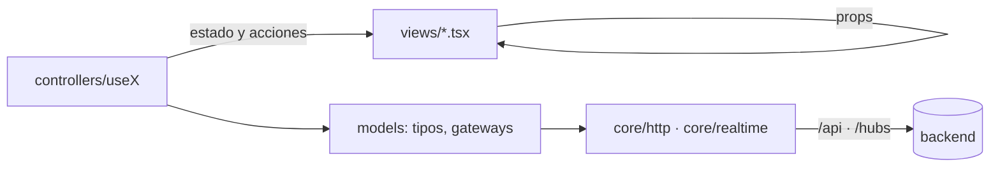

# Frontend MVC

El frontend (`frontend/`, React 19 + TypeScript sobre Vite y Node 24) organiza cada funcionalidad en **Modelo, Controlador y Vista** ([[adr-0003-frontend-mvc]]). React es la capa de vista; los controladores son hooks y los modelos son TypeScript puro.

## Estructura

```text
frontend/src/
├── main.tsx                 arranque: BrowserRouter, fuente Archivo autoalojada, tokens
├── app/                     App, AppRoutes, guardas (RequireSession, RequireAccess),
│                            AuthenticatedShell, páginas y shellContext: conectan controladores con vistas
├── core/http/               httpClient (get/post/put/patch/delete), httpError, problemDetails,
│                            antiforgery (caché en memoria), authEvents (manejadores globales 401/403)
├── core/realtime/           conexión SignalR compartida (cuando exista el chat)
├── modules/<modulo>/
│   ├── models/              tipos, normalización de datos externos, gateways (xxxGateway.ts)
│   ├── controllers/         hooks useXController: estado + acciones
│   └── views/               componentes puros (props → JSX)
├── modules/session/         CurrentUser, navigationFor, canAccessSection, sanitizeReturnUrl, useSessionController,
│                            AppLayout (+ ShellNavigation, ShellUser), ForbiddenView
├── modules/auth/            loginForm, loginState, authGateway · useLoginController, useLogoutController · LoginView, LoginField
├── shared/ui/               InternalLink, BrandMark, LoadingView (genéricos, sin router ni core)
├── styles/tokens.css        tokens claro/oscuro de [[sistema-de-diseno]]
└── styles/global.css        base y primitivas sobre los tokens
```



## Reglas (las hace cumplir `oxlint`)

| Capa | Puede importar | No puede importar |
|---|---|---|
| `models/` | `core/`, otros modelos | `react`, `react-dom`, `controllers/`, `views/` |
| `controllers/` | `react`, `models/`, `core/` | `views/` |
| `views/` | tipos de `models/` y `controllers/`, `shared/ui` | `core/`, `*Gateway`, `@microsoft/signalr`, `react-router` (salvo tipos), `app/` |
| `core/` | — | `react`, `react-router`, `modules/`, `app/`, `shared/` |
| `shared/` | `react` | `core/`, `modules/`, `app/`, gateways, SignalR, `react-router` |

Además, desde B5 del goal del login (2026-10-09): los modelos no importan `react-router` ni `app/`, y los controladores no importan `app/`. Las vistas reciben `onNavigate` y `currentItemId` por props: solo `app/` usa el enrutador.

Configuradas con `no-restricted-imports` por carpeta en `frontend/.oxlintrc.json`; se comprobó que bloquean las cinco violaciones típicas (2026-10-07). `npm run lint` debe pasar antes de cada PR.

## Módulo de referencia: `system`

| Archivo | Rol |
|---|---|
| `models/health.ts` | Tipos y `toHealthSummary()`: normaliza el JSON de `/api/health` (estados desconocidos → `Unhealthy`) |
| `models/healthGateway.ts` | `fetchHealth()` sobre `core/http` (acepta 503 como respuesta válida) |
| `controllers/useHealthController.ts` | Estado discriminado `loading/ready/error`, cancelación con `AbortController`, `retry()` |
| `views/HealthStatusView.tsx` | Render puro con `role="status"`/`role="alert"` |
| `models/health.test.ts` | 3 pruebas Vitest |

## Integración con el backend

- Rutas relativas (`/api/...`, `/hubs/...`); nunca `http://localhost:8080` en el código. El proxy está en `vite.config.ts` (`VITE_API_PROXY_TARGET`) y en `frontend/nginx/default.conf.template`.
- Sesión por cookie `HttpOnly`; nada de tokens en `localStorage` ([[autenticacion-identity]]).
- SignalR con `@microsoft/signalr` (10.0.x) en `core/realtime`, reconexión automática y recuperación por cursor ([[tiempo-real-signalr]]).
- Superficies separadas: **portal del cliente** (estado resumido y respuesta formal) y **espacio interno** (triage, chat, dashboard). El portal nunca solicita datos internos ([[roles-y-permisos]]).

## Decisiones abiertas

- Enrutador: `react-router` 8.4.0 en modo librería, con rutas y guardas en `src/app` y sin `loader`/`action` para datos ([[adr-0010-enrutador-react-router]]). Librería de estado de servidor: no se adopta por ahora ([[pendientes]] §4).
- Estilo visual: tokens y componentes según [[sistema-de-diseno]] (inspiración `DataTicket.html`, [[adr-0011-estilo-visual-inspirado-en-el-prototipo]]).
- ~~Testing Library + jsdom~~ incorporados el 2026-10-09 (B5).

## Shell y navegación (HU-002, desde 2026-10-09)

- Al cargar, `useSessionController` pide `/api/auth/me` (sin disparar el manejador global de 401) y expone `loading | anonymous | authenticated | error`, `refresh()` y `endSession()`.
- Guardas en `src/app`: `RequireSession` (sin sesión → `/ingresar?returnUrl=`) y `RequireAccess section=…` (superficie o sección ajena → «sin permiso» en la misma URL, dentro del layout del usuario). Cada ruta protegida **declara** su `SectionId` en `SECTION_ROUTES` y la guarda decide con `canAccessSection`: nunca se deduce la sección de la URL (así `/interno/%61dministracion` no la evita). Un `403` de la API navega a `/sin-permiso`.
- Entrada (HU-003, B6): `useLoginController` (estado `idle | submitting | error`; el reductor emite a qué campo va el foco tras un fallo) y navegación tras el login derivada del estado de sesión en `SignInPage` (al `returnUrl` saneado o a la superficie). `useLogoutController` (en el módulo `auth`, no en el controlador de sesión como sugería T-08 de HU-003, para que `session` no dependa de `auth`) llama `POST /api/auth/logout` y expone `isSigningOut`; con `401` descarta igualmente la sesión local, con otros errores la conserva y avisa.
- `useSessionController` aborta el `/me` en curso al cerrar sesión o ante un `401` global (una respuesta tardía no restaura la sesión).
- `navigationFor(user)` sale de una única tabla de secciones (`navigation.ts`), de la que también derivan `canAccessSection` y `homePathFor`. Un interno sin `ProductManager`/`Administrator` que abre a mano `/interno/triage` o `/interno/administracion` ve «sin permiso» (*propuesta*, extensión de UX del contrato; la barrera real es el backend).
- El módulo `system` (salud) vive en `/interno/estado` («Estado del sistema»), solo en el espacio interno.

## Relacionado

- [[arquitectura-general]] · [[backend-hexagonal]] · [[estrategia-de-pruebas]] · [[stack-y-versiones]]
