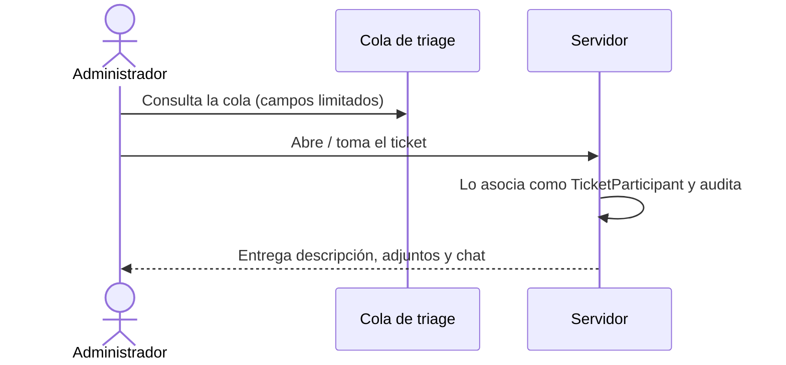

# Roles y permisos

Quién puede ver y hacer qué en DataTicket. La autorización se aplica **en servidor en cada operación**; ocultar algo en la interfaz no es aislamiento (PRD §5, §12).

## Perfiles

| Perfil | Código | Superficie | Puede | No puede |
|---|---|---|---|---|
| Solicitante | `Requester` | Portal del cliente | Radicar; ver sus propios tickets, estado resumido y respuesta formal | Ver chat interno ni tickets ajenos (PRD §5) |
| Coordinador de empresa | `CompanyCoordinator` | Portal del cliente | Radicar; ver todos los tickets de su empresa | Ver chat interno ni otras empresas (PRD §5) |
| PM (Elizabeth) | rol `ProductManager` | Espacio interno | Ver todos los tickets; triage; asignar y reasignar; gestionar participantes; acceder siempre al chat; respuesta formal; cierre (PRD §5, §6.5) | — |
| Administrador | `Administrator` | Espacio interno | Administrar el sistema; agregar o retirar participantes; cubrir triage; respuesta formal; cierre (PRD §5, §6.5) | Ver mensajes y archivos solo por ser admin (PRD §5) |
| Desarrollo | `Team.Development` (hoy rol de Identity `Development`) | Espacio interno | Trabajar y chatear en los tickets **a los que está asociado** (PRD §5) | Ver detalle o chat sin asociación (PRD §6.2, §10) |
| Producción | `Team.Production` (hoy rol de Identity `Production`) | Espacio interno | Casos de Producción; Julián lidera (PRD §5) | Ídem Desarrollo |

Personas concretas del piloto: [[equipo-data-global]].

> [!info] Decisión — equipos como roles de Identity, expuestos en `teams`
> Los equipos se implementan como los roles de Identity `Development` y `Production` (`RoleNames.Teams`), sin tablas de equipos. La API los expone aparte de los roles: campo `teams` de `GET /api/auth/me` e `ICurrentUser.Teams`. Es la decisión de B1 del goal del login, mantenida en B4 sin cambios de esquema; el modelo definitivo sigue abierto para [[hu-009-administrar-usuarios-internos-y-equipos|HU-009]] ([[pendientes]] §1, [[autenticacion-identity]]).

## Las 7 reglas de autorización (PRD §5)

1. **Aislamiento por empresa.** Un usuario cliente solo consulta tickets de su empresa: el solicitante los propios, el coordinador los de toda la empresa.
2. **Servidor siempre.** Se autoriza en backend en cada operación; ocultar filas en la UI no cuenta.
3. **Chat solo para participantes vigentes.** Excepción: Elizabeth siempre accede para triage y seguimiento.
4. **Gestión de participantes.** PM y administradores agregan o retiran. Agregar da acceso al historial completo; retirar revoca el acceso futuro y conserva la participación pasada en historial y auditoría.
5. **El admin no ve contenido por ser admin.** En cobertura ve solo los campos de la cola; al tomar un ticket queda asociado **antes** de cargar detalle y adjuntos.
6. **Opacidad hacia el cliente.** Nunca ve mensajes internos, estados técnicos, URL de PR, nombres de colaboradores internos ni actividad privada de otros clientes.
7. **Respuesta formal restringida.** Solo Elizabeth o un administrador la envía.

## Políticas de autorización implementadas (B4, HU-004)

Desde el 2026-10-12 el backend registra cuatro políticas con nombre y una política de reserva (`AuthorizationPolicies`, [[autenticacion-identity]]). La matriz siguiente es la que comprueba `AuthorizationPolicyTests` con principales construidos y `SessionAuthorizationTests` con sesiones reales. Las cuatro se declaran en una única tabla de `AuthorizationPolicies` (nombre, exclusiva de internos, condición) de la que derivan el registro y las listas `All` e `InternalOnly`; una política añadida fuera de esa tabla hace fallar la prueba.

| Perfil de la sesión | `ClientUser` | `InternalUser` | `Administrator` | `ProductManagerOrAdministrator` | Reserva |
|---|---|---|---|---|---|
| `Requester` con `company_id` | Sí | No | No | No | Sí |
| `CompanyCoordinator` con `company_id` | Sí | No | No | No | Sí |
| `ProductManager` (con o sin equipo) | No | Sí | No | Sí | Sí |
| `Administrator` | No | Sí | Sí | Sí | Sí |
| Solo equipo `Development` o `Production` | No | Sí | No | No | Sí |
| Autenticado con perfil no válido | No | No | No | No | Sí |
| Anónimo | No | No | No | No | No |

Qué exige cada una (se evalúan sobre el perfil leído de los claims de la sesión, el mismo que ve `ICurrentUser`):

| Política | Condición implementada |
|---|---|
| `ClientUser` | Perfil válido de cliente: rol `Requester` o `CompanyCoordinator`, ningún rol interno y claim `company_id` |
| `InternalUser` | Perfil válido interno: al menos uno de `ProductManager`, `Administrator`, `Development` o `Production`, ningún rol de cliente y sin `company_id` |
| `Administrator` | Perfil válido interno con el rol `Administrator` |
| `ProductManagerOrAdministrator` | Perfil válido interno con el rol `ProductManager` o `Administrator` |
| Reserva (*fallback*) | Usuario autenticado, sin mirar el perfil; se aplica a todo endpoint registrado que no declare `AllowAnonymous` |

Reglas que conviene tener presentes:

- **Son la primera barrera, no la única.** Cada caso de uso autoriza además contra el recurso concreto con `ICurrentUser` (PRD §5 regla 2, [[backend-hexagonal]]).
- **Ninguna concede contenido de tickets.** Ser `Administrator` o pertenecer a un equipo no da acceso al detalle, los adjuntos ni el chat de un ticket (PRD §5.5; invariante 5 de `AGENTS.md` §7; PRD §6.2). Eso lo decidirá la participación en las HU de tickets. `AuthorizationPolicyTests` comprueba que las políticas registradas son exactamente estas cuatro y que no existe ninguna de contenido.
- **Un perfil no válido no satisface ninguna política con nombre.** Son perfiles no válidos: sin roles, solo con roles desconocidos, cliente sin `company_id` o con uno mal formado, mezcla de roles de cliente e internos, e interno con `company_id`. La sesión sigue autenticada: pasa la reserva y recibe `403` en lo demás.
- **Un equipo no es un rol.** `Development` y `Production` solo abren `InternalUser`; no satisfacen `Administrator` ni `ProductManagerOrAdministrator`, e `ICurrentUser.IsInRole("Production")` es falso.
- **Respuestas.** Sin sesión, `401`; con sesión y sin satisfacer la política, `403`; ambas en `application/problem+json`.
- **Uso actual.** Ningún endpoint de producto usa todavía las políticas con nombre: `logout` y `/me` solo exigen sesión. Las aplicarán las HU posteriores.

## Cobertura de triage por un administrador

Durante la ausencia de Elizabeth (PRD §5, §6.2, §10):

| Visible en la cola (antes de asociarse) | Oculto hasta asociarse |
|---|---|
| Número, empresa, título, categoría, urgencia, impacto, prioridad calculada, fecha de creación, estado resumido | Descripción completa, archivos, chat |

La asociación ocurre **antes** de entregar el detalle (PRD §5, §14.3).

> [!question] Pendiente
> El PRD no define cómo se determina la "ausencia" de Elizabeth: ¿la cola de cobertura está siempre disponible para administradores o se activa de algún modo? Ver [[pendientes]].

## Aislamiento multiempresa (PRD §12)

- Cada ticket pertenece a una empresa cliente; toda consulta del portal se filtra por empresa y permisos en servidor.
- La capa de datos debe evitar consultas accidentales entre empresas; se recomienda evaluar filtros globales y seguridad a nivel de fila de PostgreSQL. Ver [[persistencia-postgresql]].
- Excepción conocida: los archivos con URL pública. Ver [[archivos-adjuntos]].

## Ciclo de vida de cuentas

- **Sin registro público.** Data Global crea, invita y desactiva las cuentas de empresas cliente (PRD §5).
- **Invitación y restablecimiento seguros**, sin revelar si un correo está registrado; token de un solo uso (PRD §5, §12).
- Contraseñas con una solución estándar de identidad y derivación segura; nada de cifrado reversible ni hash casero (PRD §12). Ver [[autenticacion-identity]].
- Todo acceso exige autenticación, salvo páginas de entrada expresamente públicas (PRD §12).
- **MFA, SSO y federación** quedan fuera del MVP (PRD §5, §13).
- La lista inicial de personas es para el piloto; las futuras se administran dentro de DataTicket (PRD §5).

## Regla de acceso interno implementada (N1)

`TicketAccessPolicy.CanAccessInternalAsync(ticketId, ICurrentUser)`: la PM accede si el ticket existe; cualquier otro interno, **administrador incluido**, solo con participación vigente (invariantes 3 y 5); un retirado, un equipo no participante, un cliente, un anónimo o un perfil no válido no acceden. Consulta la base en cada llamada, sin caché. Un ticket inexistente y uno no visible dan el mismo `false`, que es la base del 404 de P-01.

## Relacionado

- [[autenticacion-identity]] · [[adr-0004-autenticacion-cookie-mismo-origen]] · [[hu-004-contexto-de-usuario-y-autorizacion]] · [[backend-hexagonal]] · [[estrategia-de-pruebas]] · [[pendientes]]
- [[chat-interno]] · [[flujo-del-ticket]] · [[estados-del-ticket]] · [[auditoria]]
- [[elizabeth-pm]] · [[equipo-data-global]] · [[glosario]] · [[criterios-de-aceptacion]]
